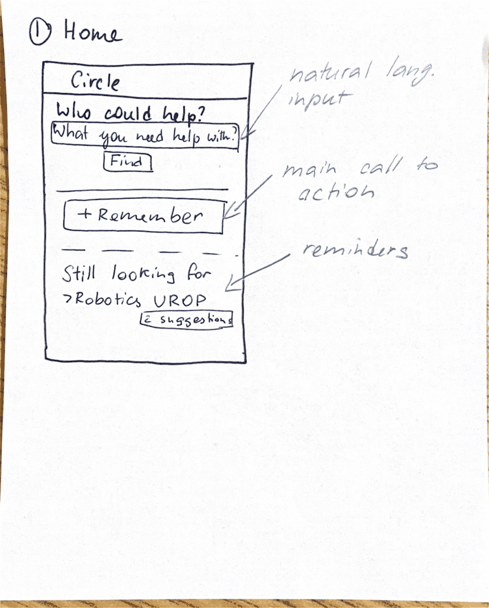
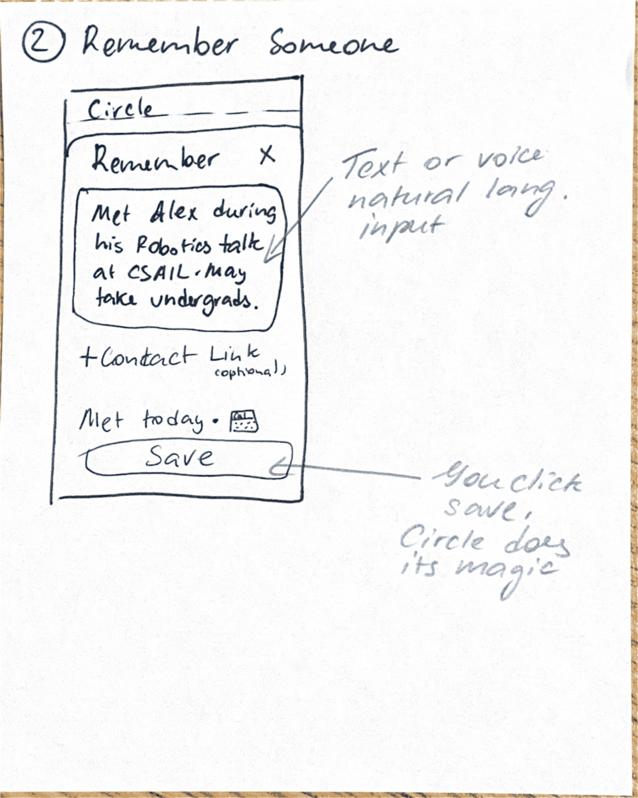
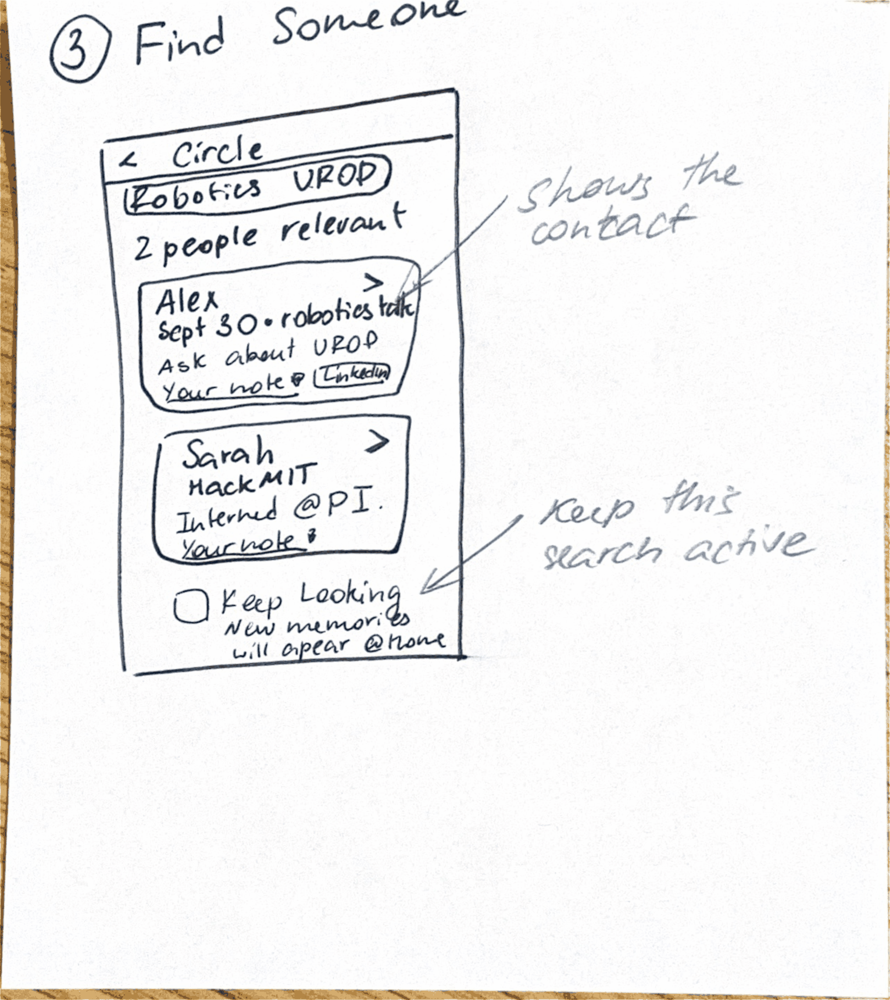
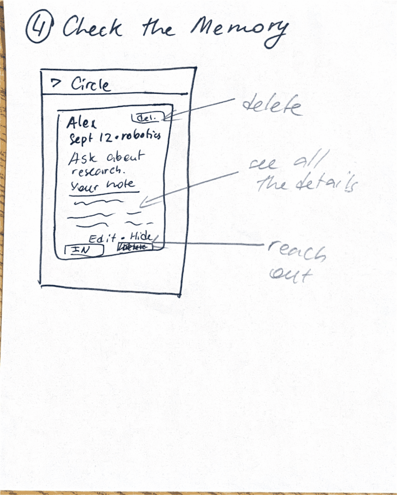

# UI sketches

Original scans: [UI.pdf](UI/UI.pdf).

## 1. Home

Natural-language search (“Who could help?”), a primary **Remember** action, and reminders for still-active needs (for example, a robotics UROP) with a link to suggestions.

## 2. Remember Someone

Capture an encounter as a text or voice note. An optional contact link and date are available; tapping **Save** is the only required action.

## 3. Find Someone

Results for a need (for example, a robotics UROP): each card shows the person, why they came up, and the original note. **Keep looking** leaves the search active so later memories can appear on Home.

## 4. Check the Memory

The full saved account for a person: original note, edit or hide, delete, and a way to reach out (for example, LinkedIn).

