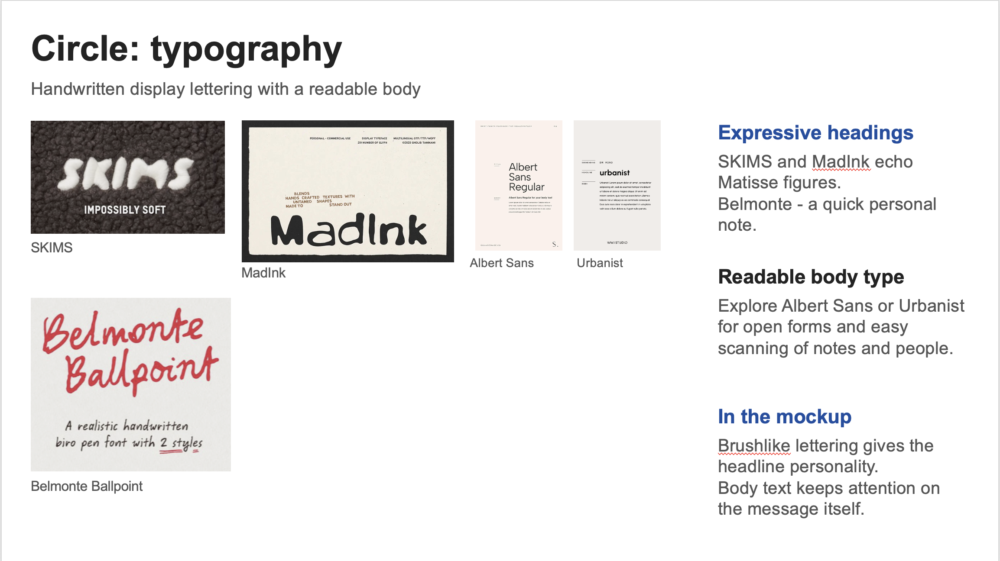
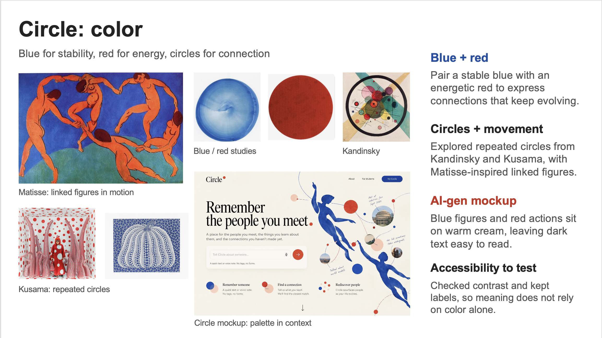

# Visual study: implemented typography and color

Circle’s interface uses handwritten display type, quiet contact rows and restrained blue/red accents to connect the personal character of encounter notes with readable retrieval. The study images below preserve earlier references and candidates; the implemented pairing is **Handlee + Urbanist**.

## Typography

**Handlee** is bundled locally and used for the Circle wordmark and display headings, including the sign-in message and edit-dialog heading. Its handwritten shape gives the interface the character of a personal notebook. It replaced the earlier SKIMS/MadInk/Belmonte explorations shown in the study. Those fonts are not shipped in the interface.

**Urbanist** is bundled locally for body text, forms, buttons, search, contact names, field labels and recent-people headings. It provides a consistent reading rhythm for longer notes. Contact names use a stronger weight; supporting details and the nested Personal notes heading use 14px Urbanist. Albert Sans was an earlier candidate; the implemented body font is Urbanist. Both font license files live beside the assets.

## Color and roles

The study’s Matisse figures suggest connection and movement; Kandinsky’s shapes and Kusama’s repeated circles informed the rounded controls and artwork. The implementation keeps artwork movement on hover and honors reduced motion. The actual palette comes from [style.css](../code/frontend/src/style.css):

| Token / surface | Value | Role |
| --- | --- | --- |
| Page | #f6f2e9 | Warm cream canvas, with a subtle texture |
| Form/input surface | #fffdf8, sometimes translucent | Warm surface for writing and searching |
| Contact rows | #ffffff | Plain white rows that keep notes easy to scan |
| Body / ink | #252525 / #20231f | Reading text and strong names |
| Muted | #62615d | Supporting labels, hints and account name |
| Blue | #2455a4 | Selected modes, search feedback, focus and edit controls |
| Vermilion | #e74735 | Decorative wordmark dot, punctuation and artwork |
| Action / hover | #b83225 / #97271d | Save and removal actions, with white text |
| Quiet line | #d9d6ce | Subtle grouping borders |

Blue provides a stable navigation and reading cue; red marks deliberate actions. Text/Voice/Form retain equal widths, icons and the same selected treatment, with visible words for touch and keyboard use. Search distinguishes progress, a found count, empty results and failures through words and status/alert semantics. Removal is identified by its accessible name and a named confirmation dialog; meaning does not rely on red versus blue alone.

## Measured contrast and limits

The reproducible [sRGB contrast calculation](../code/scripts/check-contrast.ts) and [saved output](../code/tests/output/contrast.txt) measure these solid token pairs:

| Pair | Ratio |
| --- | --- |
| Body #252525 on cream | 13.72:1 |
| Ink on white rows | 15.89:1 |
| Muted on cream | 5.55:1 |
| Blue on cream | 6.46:1 |
| White on action / action hover | 5.96:1 / 8.00:1 |
| Warm white selected toggle on blue | 7.15:1 |
| Placeholder on solid warm input | 4.81:1 |
| Decorative vermilion on cream | 3.51:1 |
| Quiet line on white | 1.45:1 |

The listed text pairs exceed 4.5:1 in the solid-token calculation. Decorative vermilion is not a small-text color, and quiet borders do not establish a 3:1 control-boundary claim. The calculation excludes transparency, gradients, hover artwork and disabled opacity; it is not a full WCAG audit. Keyboard, narrow-layout, enlarged-content and dialog checks are recorded separately in [verification](verification.md). No blanket accessibility or color-vision certification is claimed.
